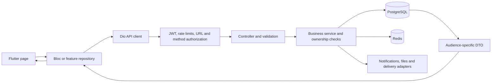

# AIWA production audit — 2026-10-05, round 3

## 1. Executive Summary

**Production recommendation: do not launch yet.** The existing test suites pass, and substantial authentication, finance and deployment hardening is present. This audit nevertheless confirms additional privacy leaks, overly broad access to sensitive admin queues, an image-decoder memory exhaustion path, mutable booking destinations, and broken customer/admin operations. Safety monitoring and restore failure handling also need attention before production reliance.

The system is a Flutter customer/provider application, a Java 17/Spring Boot monolith, a React administration application, PostgreSQL, Redis, and a single-host Docker/Caddy deployment. Payments are cash confirmations and an internal provider commission ledger; there is no card processor, stock or inventory workflow to audit.

**Baseline:** `ac67446495a22ce11b8f2071d0f1599f3c0cdee4` on `main`, clean when checked. Review began at `2bceba560eec7c47cc5a20d707795f88af7cb789`; a concurrent commit advanced the repository, and its changes were incorporated before final backend validation. Project root: `D:\AIWA PROJECT\AIWA`. All locations below refer to this root and current source unless explicitly identified as historical. No application source, dependency, migration or deployment configuration was changed during this audit. The requested report and handoff are the only repository updates.

Evidence labels have different meanings:

- **CONFIRMED:** a defect follows directly from current source; a reproduction is identified where performed. This does not mean it was exercised against production.
- **LIKELY:** a plausible outcome with strong supporting evidence but an untested assumption.
- **POTENTIAL / NEEDS RUNTIME VERIFICATION:** a configuration, concurrency, operating-system or provider condition that must be tested before calling it an observed incident.
- Passing a test suite establishes its assertions, not complete feature correctness, security or production capacity.

Validation performed in an isolated source copy, using synthetic fixtures and cached dependencies:

| Check | Result | Practical limit |
| --- | --- | --- |
| Backend, JDK 17.0.19, offline Maven | **411 tests, 0 failures/errors/skips** | Existing suite; no live production database/provider |
| Admin, Node 20.20.2 | **120 tests in 20 files pass; production build passes** | Vitest/jsdom; no new real-browser session in this pass |
| Admin npm advisory scan | **0 reported vulnerabilities** | Advisory database at audit time; not a security proof |
| Flutter 3.47.5 / Dart 3.13.4 analysis | **No issues found** | Analyzer rules, not runtime behavior |
| Flutter tests | **178 pass**, including English/Arabic goldens | Host tests; no Android/iOS hardware or release archive |
| Backup/restore shell suite | **31 pass, 0 fail** | Fake Docker harness; NTFS permission-mode assertion skipped |
| Isolated Spring/H2 probes | Six findings reproduced | Controller/service fixtures, not a full proxy/JWT deployment |
| Isolated JDK PNG decoder, 128 MB heap | Memory exhaustion reproduced | Bounded subprocess; no live upload attack |

Backend's initial snapshot run had one missing monitoring fixture; the fixture was copied and the complete current run passed. Initial sandbox/tool-access failures were environmental and are not counted as product failures. The old handoff's claim that Flutter was unavailable is obsolete: it is installed at `D:\tools\flutter`.

Supporting artifacts: [complete API inventory](api-inventory.md), [API business and ownership flows](api-flows.md), [dashboard evidence](dashboard.md), [coverage and validation manifest](coverage.md), and [verification logs](validation/README.md). The API inventory covers **181 mapped handler methods across 29 controllers**, with exact source mappings, access annotations, inputs, constraints, operations, responses and error behavior. Multi-verb handlers count once.

Previously reported issues now closed in source include memory-only admin access tokens plus an HttpOnly refresh cookie, mandatory admin MFA by default in production, narrowed user/contact/finance/audit controls, production encryption guards, disabled production open-in-view, settlement amount/reference checks and frozen payout reports, commission snapshots, bounded local throttle fallback, required offsite backup service, SHA-pinned CI actions, temporary-password expiry, Redis/cash alerts, and production APNs entitlements. They are not repeated here as open defects. Operational evidence is still needed for those controls in the deployed environment.

## 2. System Architecture

| Area | Location | Design and responsibility |
| --- | --- | --- |
| Mobile | `D:\AIWA PROJECT\AIWA\Android\aiwa_app` | Feature data/domain/presentation layers; Bloc, GetIt, Dio, go_router; separate customer and provider shells; secure token storage; guest discovery; localization and shared design widgets |
| Backend | `D:\AIWA PROJECT\AIWA\aiwa-backend` | Spring Boot 3.5.16, Java 17, MVC controllers, services, Spring Security, JPA repositories, Flyway; centralized errors and i18n; scheduled jobs and integration adapters |
| Administration | `D:\AIWA PROJECT\AIWA\aiwa-admin-dashboard-updated` | React 18.3.1, Vite 6.4.3, one large App component tree and API adapter; in-memory/tab navigation, permission-sensitive controls, polling queues |
| Database | Backend entities/repositories and `src\main\resources\db\migration` | PostgreSQL 16; 32 SQL migrations plus Java V19 migration; financial snapshots, optimistic versions, targeted pessimistic locks, historical records |
| Ephemeral state | Redis | OTP state, request throttles, cache, token revocation acceleration, distributed job locks; selected database/local fallbacks |
| Files | Backend storage service and Docker uploads volume | Public avatars/gallery are normalized images; private identity documents are separately authorized and encrypted; database stores references |
| Edge/operations | `D:\AIWA PROJECT\AIWA\deploy` and `.github\workflows` | Caddy TLS/proxy, unprivileged nginx admin, resource-limited backend, PostgreSQL/Redis, encrypted backups, required offsite copy, monitoring, CI/security checks, runbooks |
| Integrations | SMS/email HTTP adapters, Firebase FCM, Sentry | OTP and incident delivery, device tokens, push, crash/error reporting; configuration determines real versus local/test providers |

Mobile data flow:

Admin authentication uses a memory access token, an HttpOnly/Secure/SameSite=Strict refresh cookie scoped to `/api/auth`, and a non-secret localStorage session hint/activity timestamp. Refresh needs `X-Requested-With: aiwa-admin`; rotation is serialized with a Web Lock and generation checks. Requests then traverse the same backend checks, including the admin two-factor interceptor and named permissions. A frontend hidden button provides no server authorization.

Important end-to-end workflows reviewed:

1. **Registration/login:** client collects role/contact/password and OTP; backend blocks ADMIN registration, validates contact/role/password, consumes OTP, hashes with BCrypt, applies attempt limits and returns purpose-typed tokens. MFA challenge completion and single-use/replay checks are separate from normal access/refresh. Profile refresh populates client identity; that successful-response path has the mobile race in M-01.
2. **Discovery/booking:** guest discovery filters approved active providers; public home locations are rounded/hidden. Customer sends service/staff/slot/home address plus an idempotency key. Service checks ownership, availability, radius, overlap and price, locks appropriate records, snapshots commission/fees and writes a PENDING booking. Notifications and client state follow. The booking DTO bypasses public location masking (B-02), and its address remains a live reference (B-05).
3. **Visit/cash closeout:** provider acceptance/proposal/travel/check-in/start/completion and customer responses use allowed states and participant checks. Cash collection/dispute decisions feed commission entries. Finance resolves disputes and settlements, with amount comparison and frozen ledger reports. Dashboard settlement display incorrectly hides a remaining balance after one payout (AD-03); this is a UI defect, not evidence of an incorrect backend transfer.
4. **Verification/moderation:** provider uploads private IDs/selfie; support reads authorized decrypted documents and makes audited decisions. Public gallery reports, chat reports, reviews and complaints have distinct queues. Some reads still permit any ADMIN (B-04), although mutations and other queues have narrower permissions.
5. **Safety:** a booking participant raises SOS with position; the event, contacts, delivery/retry state and admin queue are persisted. SMS/on-call routing and push are independent of the dashboard's configured public support email. Silent dashboard polling failures and inaccurate email promises can undermine incident response (AD-05/12).
6. **Disaster recovery:** scheduled database dump and uploads tar are checked/encrypted and copied offsite. Restore validates a scratch database before replacing live data transactionally. Upload replacement remains destructive and lacks equivalent rollback (I-02); dump/files are not a single consistent snapshot (I-03).

Public production deployment is a single host. Only Caddy publishes HTTP/HTTPS ports in the main compose stack. Backend is non-root/read-only with dropped capabilities and tmpfs, limited to 1536 MB and two CPUs; PostgreSQL and Redis use persistent volumes. This is a reasonable initial deployment topology, but availability, data volumes, disk capacity and concurrency must be measured. There is no evidence for a defensible user-count capacity promise.

## 3. Critical Issues

**No confirmed Critical finding at the audited commit.** High findings below are still production blockers. There was no demonstrated unauthenticated account takeover, arbitrary SQL execution, private-document path traversal, card-payment loss or production data corruption. This statement is limited to the reviewed code and checks, not a guarantee of absence.

## 4. High Priority Issues

### B-01 — Authenticated image upload can exhaust the decoder heap

**Issue:** PNG dimension checks do not bound scanline allocation. **Location:** avatar/gallery upload → image normalization. **File:** [FileStorageServiceImpl.java:231](<D:/AIWA PROJECT/AIWA/aiwa-backend/src/main/java/com/aiwa/service/impl/FileStorageServiceImpl.java:231>). **Function/Class:** `FileStorageServiceImpl` image-reader path, lines 231–246. **Severity:** High. **Category:** Security / availability. **Evidence:** CONFIRMED codec reproduction; production endpoint crash not executed.

**Description:** The configured limit is 200 million pixels, with subsampling to approximately 2048 pixels on the long side. JDK PNG decoding still allocates buffers for the original row width. A tiny PNG header describing 20,000,000 × 1 RGBA pixels passes the area check; the bounded probe exhausted 128 MB in `PNGImageReader.decodePass` before rejecting its incomplete pixel data. Subsampling does not bound these intermediate allocations. Larger accepted widths and two decode slots threaten the roughly 1152 MB production heap; `ExitOnOutOfMemoryError` increases outage impact.

**Why it is dangerous:** An authenticated uploader can trigger expensive allocation with a very small request; an hourly upload budget does not protect the first request. **How to reproduce/verify:** See `validation/png-probe.txt`, a 66-byte synthetic input in an isolated JDK 17 process. Verify corrected validation in a bounded subprocess rather than attacking a deployed API. **Recommended fix:** Bound each dimension, decoded row bytes, aspect ratio and estimated decoder working memory before `reader.read`; reject implausible headers; consider an isolated, time/memory-limited decode worker. Retain subsampling and concurrency limits as additional controls.

### B-02 — Pending booking responses disclose a home provider's exact location

**Issue:** Booking/alternative-provider mappers omit the public privacy policy. **Location:** `GET /api/bookings/{id}` and booking alternative suggestions. **File:** [BookingServiceImpl.java:1964](<D:/AIWA PROJECT/AIWA/aiwa-backend/src/main/java/com/aiwa/service/impl/BookingServiceImpl.java:1964>). **Function/Class:** `toProviderSummary`, `findAlternativeProviders` at 1753, `toDto` at 1915. **Severity:** High. **Category:** Privacy / sensitive data exposure. **Evidence:** CONFIRMED mapping and synthetic pending-booking probe.

**Description:** `ProviderServiceImpl.hideHomeLocation` masks public home provider addresses/coordinates, but booking summaries copy address/latitude/longitude directly, including PENDING requests. Alternative summaries likewise bypass the masking helper. **Why it is dangerous:** A customer can obtain the exact home location before the provider agrees to the appointment, undermining the deliberate public privacy boundary. **How to reproduce/verify:** Use a home-provider fixture, create a pending customer booking, compare public discovery with booking detail and alternative responses. The fixture detail returned the synthetic exact address and coordinate. **Recommended fix:** Share one audience/state-aware mapper. Public suggestions must always use the public projection; define exactly which accepted states permit an exact address, and test pending, rejected, cancelled and terminal responses.

### B-03 — Provider dashboard bypasses booking contact visibility restrictions

**Issue:** Dashboard bookings contain customer email/phone outside permitted states. **Location:** `GET /api/provider/dashboard`. **File:** [ProviderServiceImpl.java:202](<D:/AIWA PROJECT/AIWA/aiwa-backend/src/main/java/com/aiwa/service/impl/ProviderServiceImpl.java:202>). **Function/Class:** `getDashboard`, `toBookingDto` at 435, `toUserDto` at 408. **Severity:** High. **Category:** Privacy / API minimization. **Evidence:** CONFIRMED fixture and source.

**Description:** Dashboard mapping always copies email/phone. The booking service's `CONTACT_VISIBLE` set at line 89 and `getContact` at 536 permit those contacts only in active accepted visit states. PENDING and terminal bookings are not equivalently masked in the dashboard. **Why it is dangerous:** A provider gets contacts the dedicated endpoint intentionally denies, across a batch of recent bookings. **How to reproduce/verify:** Read a provider dashboard containing a PENDING customer fixture and compare `/bookings/{id}/contact`; the probe returned synthetic customer email/phone in the pending row. **Recommended fix:** Reuse the same contact-minimized projection or omit contacts from dashboards; test every state and both audiences.

### B-04 — Any ADMIN can read support-sensitive queues and staff details

**Issue:** ADMIN membership allows sensitive reads without the support capability. **Location:** `/api/admin/safety`, `/admin/chat/moderation`, `/admin/reviews`, `/admin/reviews/moderation`, `/admin/flags`, `/admin/providers/{providerId}/staff`. **File:** [SafetyController.java:68](<D:/AIWA PROJECT/AIWA/aiwa-backend/src/main/java/com/aiwa/controller/SafetyController.java:68>); also `ChatController.java:132`, `AdminController.java:167`, `AdminProviderSettingsController.java:58`, and `ReviewController.java` moderation mapping. **Function/Class:** queue/report/list handlers and DTO mappers. **Severity:** High. **Category:** Authorization policy inconsistency / privacy. **Evidence:** CONFIRMED annotations; synthetic principal with ADMIN and no SUPPORT successfully read SOS notes, position and actor phone.

**Description:** These handlers use `ANY_ADMIN`/`hasRole('ADMIN')` or inherit the broad class annotation, although complaints, verification and user reads elsewhere enforce narrower capabilities. SOS responses contain precise locations, contact information and incident notes; reported chat contains private content; staff history contains contacts. Review serialization separately fails under production OSIV settings (B-06); its broad permission remains a latent exposure once serialization is repaired.

**Why it is dangerous:** Finance-only or permissionless administrative accounts can read unrelated sensitive operational data. MFA enrollment verifies the administrator, not their entitlement. Current `Perms` comments retain a broad-read default, so this is confirmed sensitive exposure and inconsistent least-privilege scope, not a claim that a handler violates its own ANY_ADMIN annotation; an explicit read-policy decision is needed. **How to reproduce/verify:** In staging use enrolled ADMIN accounts with no permission, FINANCE only and SUPPORT; inspect each response and private fields. The fixture exercised the method-security/controller boundary, not the full MFA/JWT proxy chain. **Recommended fix:** Establish a documented read capability matrix, narrow sensitive queues to SUPPORT or an explicitly justified combined capability, minimize fields, and filter mixed inbox items accordingly. Add negative tests for every handler and permission combination.

### B-05 — Editing a saved address silently changes an existing booking

**Issue:** Booking destination is a mutable account record rather than a snapshot. **Location:** `PUT /api/account/addresses/{id}` → existing home-service booking. **File:** [AccountController.java:84](<D:/AIWA PROJECT/AIWA/aiwa-backend/src/main/java/com/aiwa/controller/AccountController.java:84>); `entity\Booking.java:44`; `service\impl\BookingServiceImpl.java:1923`. **Function/Class:** `updateAddress`, booking saved-address relation and DTO. **Severity:** High. **Category:** Data integrity / visit safety. **Evidence:** CONFIRMED synthetic fixture.

**Description:** Creation checks service radius and computes the price using the saved address. Later account edits replace its address/coordinates; booking detail reads the same relation and immediately reflects the new destination without rechecking radius, repricing or notifying the other participant. History can change too. **Why it is dangerous:** An agreed visit can move outside the provider's service area while retaining its old price and acceptance; audit history no longer records the agreed location. **How to reproduce/verify:** Create/accept a nearby home appointment, edit the saved address to a distant fixture, reload booking detail. The isolated probe changed an existing pending booking from the original synthetic location to 35/35. Accepted-state behavior follows the same unguarded update path. **Recommended fix:** Store immutable booking address/coordinates at creation. A deliberate appointment amendment must be state-checked, requoted, consented to and notified; plan a safe migration/backfill.

### M-01 — Successful old profile requests can restore a signed-out identity

**Issue:** Session generation protects token refresh but not successful auth profile responses. **Location:** profile refresh/session check concurrent with logout or a new login. **File:** [auth_bloc.dart:234](<D:/AIWA PROJECT/AIWA/Android/aiwa_app/lib/features/auth/presentation/bloc/auth_bloc.dart:234>); `features\auth\data\repositories\auth_repository_impl.dart:144`. **Function/Class:** `_onGetCurrentUser`, `_onCheckSession`, `_onLogout`, `getCurrentUser`. **Severity:** High. **Category:** Mobile privacy / state integrity. **Evidence:** CONFIRMED source race; delayed-response widget/device reproduction still required.

**Description:** Auth event handlers run concurrently. A profile request begun under account A can finish after logout clears storage and emits unauthenticated, then cache A's profile and emit `AuthAuthenticated(A)`. A new account B login can similarly receive A's late cached identity. Dio generation checks are only on refresh/error retry, not this success path. **Why it is dangerous:** A shared device can display a previous account's private profile; local identity and active tokens can disagree. This is not proof that the server authorizes A's data with B's token. **How to reproduce/verify:** Delay A's profile future, complete logout/login B, then complete A's future; assert cached user and emitted state. **Recommended fix:** Capture/check session and account generation around every asynchronous cache write and identity emission; cancel/ignore obsolete success results, and reset account-scoped Blocs on session changes.

### AD-05 — SOS polling failures leave a reassuring stale display

**Issue:** Non-401 polling failures are silently swallowed. **Location:** SafetyQueue recurring refresh. **File:** [App.jsx:3615](<D:/AIWA PROJECT/AIWA/aiwa-admin-dashboard-updated/src/App.jsx:3615>). **Function/Class:** `SafetyQueue.refresh`. **Severity:** High. **Category:** Safety / operational reliability. **Evidence:** CONFIRMED source behavior; real-browser incident simulation unperformed.

**Description:** After a network/503 failure, the old list remains without a persistent stale/offline warning or last-success time. An old empty list still says there are no open SOS alerts. **Why it is dangerous:** Staff may rely on an apparently current safety queue while newly raised incidents are unseen. Independent SMS delivery mitigates but does not remove this risk. **How to reproduce/verify:** Load an empty queue, fail subsequent polls, create a synthetic incident elsewhere, observe the stale display. **Recommended fix:** Show last successful synchronization, persistent stale/offline state and retry status; prevent overlapping/out-of-order polls and test recovery. Exercise all actual on-call channels on staging.

### I-02 — Restore can erase uploads before a failing extraction

**Issue:** Filesystem restoration has no atomic swap or rollback. **Location:** uploads replacement after successful database restore. **File:** [restore.sh:82](<D:/AIWA PROJECT/AIWA/deploy/restore.sh:82>). **Function/Class:** restore upload command and failure cleanup. **Severity:** High. **Category:** Data loss / disaster recovery. **Evidence:** CONFIRMED destructive control flow; disk-full/extraction failure needs fault injection.

**Description:** Input archives and a scratch DB are validated first, which is good. After committing the DB restore, the script deletes every live upload and extracts directly into that volume. A permission, disk-full or interrupted extraction error exits under `set -e`; the prior files are gone, the DB is already replaced, and backend restart is skipped. **Why it is dangerous:** Disaster recovery can create a mismatched or partial filesystem and prolonged outage despite valid backup inputs. **How to reproduce/verify:** Use disposable volumes and a valid archive, inject extraction failure after deletion, then inspect DB/files and stopped backend. Existing fake-Docker tests do not simulate this failure. **Recommended fix:** Fully extract/verify into a staged volume, retain the previous volume and atomically switch; coordinate DB/files rollback and restart/cleanup traps. Prove failure behavior before trusting a live restore.

## 5. Medium Priority Issues

### B-06 — Admin review serialization fails with production open-in-view disabled

**Issue:** A lazy collection escapes its transaction in a DTO. **Location:** `GET /api/admin/reviews`. **File:** [AdminController.java:226](<D:/AIWA PROJECT/AIWA/aiwa-backend/src/main/java/com/aiwa/controller/AdminController.java:226>). **Function/Class:** `reviews`, `toReviewDto`; `Review.quickTags`. **Severity:** Medium. **Category:** API correctness / persistence. **Evidence:** CONFIRMED Spring/H2 reproduction.

**Description:** The controller maps inside a transaction but assigns `r.getQuickTags()` directly. JSON serialization occurs afterwards; the collection is detached and uninitialized. **Why it is dangerous:** The admin review page gets a 500 on real persisted reviews, impairing moderation. **How to reproduce/verify:** Persist a review with tags, invoke the proxied controller, then serialize the returned body with OSIV off. The probe raised `JsonMappingException` caused by `LazyInitializationException`. **Recommended fix:** Materialize/copy the collection inside the transaction; use an explicit projection/shared mapper. Add an HTTP integration test with production OSIV semantics; do not re-enable OSIV to conceal it.

### B-07 — Unsave fails because the derived delete has no transaction

**Issue:** Repository removal is invoked outside a write transaction. **Location:** `DELETE /api/users/me/saved/{providerId}`. **File:** [SavedController.java:74](<D:/AIWA PROJECT/AIWA/aiwa-backend/src/main/java/com/aiwa/controller/SavedController.java:74>); `repository\SavedProviderRepository.java:14`. **Function/Class:** `unsave`, `deleteByUserIdAndProviderId`. **Severity:** Medium. **Category:** Customer functionality / transactions. **Evidence:** CONFIRMED persisted-row fixture.

**Description:** Neither caller nor custom derived-delete declaration supplies `@Transactional`. **Why it is dangerous:** Removing a saved provider returns 500 rather than unhearting it; mocked repositories miss the failure. **How to reproduce/verify:** Save a provider in a real JPA persistence context, end that transaction, then call unsave. The probe raised `TransactionRequiredException`. **Recommended fix:** Place the operation in a transactional service/repository boundary and test existing/missing rows and duplicate deletes for idempotent success.

### M-02 — Upcoming appointments can be hidden behind an unreachable page

**Issue:** Client filters page zero before exposing pagination. **Location:** My Bookings Upcoming. **File:** [my_bookings_page.dart:85](<D:/AIWA PROJECT/AIWA/Android/aiwa_app/lib/features/bookings/presentation/pages/my_bookings_page.dart:85>). **Function/Class:** `_liveStatuses`, load and list rendering at 179–207. **Severity:** Medium. **Category:** Pagination / UX. **Evidence:** CONFIRMED control flow.

**Description:** Upcoming requests all statuses, then filters locally. If the newest page contains only terminal bookings, the empty-state return hides Load more although older live bookings exist. Backend supports comma-separated status filters. **Why it is dangerous:** Customers can miss a valid appointment. **How to reproduce/verify:** Seed 20 newer completed/cancelled bookings plus an older live booking; Upcoming appears empty. **Recommended fix:** Request the live statuses from the server and preserve continuation even when a filtered page is empty; test this exact dataset.

### M-03 — Multipart requests cannot be replayed after token refresh

**Issue:** Retrying reuses finalized Dio FormData. **Location:** upload receives 401 then successful refresh. **File:** [api_client.dart:233](<D:/AIWA PROJECT/AIWA/Android/aiwa_app/lib/core/network/api_client.dart:233>). **Function/Class:** error interceptor `_dio.fetch(opts)`. **Severity:** Medium. **Category:** API retry / uploads. **Evidence:** CONFIRMED against installed Dio 5.9.2 finalization code; end-to-end upload retry unperformed.

**Description:** Sending multipart finalizes its stream; `_dio.fetch` sends the same body again. Dio's `FormData.finalize` rejects a second finalization. **Why it is dangerous:** Avatar, gallery and identity-document uploads fail at token expiry despite successful refresh. **How to reproduce/verify:** Mock an upload 401 followed by refresh200 and upload200; assert the second multipart can be read. **Recommended fix:** Clone/rebuild replayable FormData and MultipartFiles before retry, preserving cancellation/progress and session generation. Test a real multipart body, not a JSON upload stand-in.

### M-04 — Transient profile errors remove authenticated UI state

**Issue:** Non-auth failures replace identity with `AuthError`. **Location:** current-user refresh and edit profile. **File:** [auth_bloc.dart:240](<D:/AIWA PROJECT/AIWA/Android/aiwa_app/lib/features/auth/presentation/bloc/auth_bloc.dart:240>). **Function/Class:** `_onGetCurrentUser`, `_onUpdateProfile` at 245. **Severity:** Medium. **Category:** State / error recovery. **Evidence:** CONFIRMED branch behavior.

**Description:** A network/server/validation failure discards `AuthAuthenticated` while tokens remain. Pages that check this state display guest/signed-out content. **Why it is dangerous:** Users lose coherent access/navigation after a recoverable error. **How to reproduce/verify:** Start authenticated, fail profile GET or edit with network/400, inspect Profile/My Bookings. **Recommended fix:** Keep identity in state with independent loading/error fields; clear it only for definitive session invalidation. Test retry and navigation continuity.

### M-05 — Provider onboarding cannot reliably resume partial completion

**Issue:** In-memory checkpoints and non-idempotent compound profile creation. **Location:** register → preferences → profile/staff/documents. **File:** [preferences_page.dart:45](<D:/AIWA PROJECT/AIWA/Android/aiwa_app/lib/features/auth/presentation/pages/preferences_page.dart:45>); `features\auth\data\repositories\auth_repository_impl.dart:230`; `core\router\app_router.dart:155`. **Function/Class:** `_finish`, `createProviderProfile`, `landingFor`, ProviderPendingPage. **Severity:** Medium. **Category:** Workflow recovery / business correctness. **Evidence:** CONFIRMED call ordering and navigation; process-kill sequence needs device validation.

**Description:** Profile POST can commit before one staff POST fails; the step retries profile creation and then encounters the already-existing profile. `_done` and prior onboarding data are memory-only. A restart with an incomplete provider routes to Pending, which can claim documents were received even with a null profile and has no general business-details recovery action. **Why it is dangerous:** New providers can become stranded or appear submitted while setup is incomplete. **How to reproduce/verify:** Fail staff after profile200; retry. Separately kill after registration before profile/documents, relaunch and inspect landing/actions. **Recommended fix:** Persist a server onboarding checkpoint, resume/upsert each idempotent stage, accurately render incomplete status and retain recoverable draft data.

### M-06 — Travel-buffer adjustment overwrites a newer business profile

**Issue:** A small edit submits an old full profile. **Location:** provider Schedule after a separate business-profile edit. **File:** [provider_schedule_page.dart:248](<D:/AIWA PROJECT/AIWA/Android/aiwa_app/lib/features/provider_dashboard/presentation/pages/provider_schedule_page.dart:248>); `data\provider_manage_repository.dart:54`. **Function/Class:** `_TravelBuffer._step`, `updateProfile`. **Severity:** Medium. **Category:** Lost update / data integrity. **Evidence:** CONFIRMED payload and cached-screen behavior.

**Description:** Schedule loads detail once and merges only buffer minutes into that stale map; repository PUT also sends business name, bio, address, coordinates, type and category. **Why it is dangerous:** Changing the buffer can silently restore old business fields and potentially trigger verification consequences. **How to reproduce/verify:** Load Schedule, edit business details elsewhere, return without remounting, change buffer, inspect persisted profile. **Recommended fix:** Add a narrow validated buffer update or require a version/ETag; share/refetch authoritative profile state and test concurrent edits.

### M-07 — Accepted policy version is not fully presented to the user

**Issue:** Registration acceptance fetches a policy after a static agreement; reaccept truncates its body. **Location:** terms and onboarding/reaccept. **File:** [terms_page.dart:165](<D:/AIWA PROJECT/AIWA/Android/aiwa_app/lib/features/auth/presentation/pages/terms_page.dart:165>); `preferences_page.dart:74`; `terms_reaccept_page.dart:157`. **Function/Class:** agreement spans, `_acceptTerms`, reaccept body. **Severity:** Medium. **Category:** Product correctness / informed consent UX. **Evidence:** CONFIRMED UI/API sequence; no legal conclusion is asserted.

**Description:** Registration shows static text/customer terms labeling for both roles without opening the actual current body, then accepts the fetched latest per-role version later. Reaccept displays at most six lines with ellipsis and no full-body action. **Why it is dangerous:** Recorded acceptance can refer to content the user could not read, especially after an admin update. **How to reproduce/verify:** Publish a long provider policy, register as provider and inspect the shown/accepted version; inspect reaccept beyond six lines. **Recommended fix:** Fetch/render the complete localized role-specific policy before consent, pin its displayed version, and restart review when that version becomes stale.

### M-08 — Permission priming clears the deferred booking too early

**Issue:** Resume destination is consumed at an intermediate permission step. **Location:** guest booking → sign-up → location → notification permission. **File:** [permission_priming_page.dart:117](<D:/AIWA PROJECT/AIWA/Android/aiwa_app/lib/features/onboarding/presentation/pages/permission_priming_page.dart:117>). **Function/Class:** `_done`. **Severity:** Medium. **Category:** Navigation / funnel correctness. **Evidence:** CONFIRMED assignment ordering.

**Description:** Resume is read only when next is Home, but is cleared unconditionally whenever next exists. The location step's next is notifications, so the final step has no booking to resume. **Why it is dangerous:** Registration unexpectedly loses the appointment intent. **How to reproduce/verify:** Start sign-up from a provider booking gate, complete both permission screens and inspect the final route. **Recommended fix:** Clear only when the final consuming destination uses it; preserve through allow/deny/settings paths and test the full route sequence.

### M-10 — Booking filter requests can overwrite the newly selected query

**Issue:** List/filter changes and load-more share mutable state without response generations. **Location:** My Bookings tab/filter switching. **File:** [booking_bloc.dart:68](<D:/AIWA PROJECT/AIWA/Android/aiwa_app/lib/features/bookings/presentation/bloc/booking_bloc.dart:68>). **Function/Class:** `_onLoadMy`, `_onLoadMore` at 89. **Severity:** Medium. **Category:** Concurrency / stale state. **Evidence:** CONFIRMED control flow; timed widget reproduction recommended.

**Description:** The single-load-more flag correctly prevents duplicate taps within one query, but a new load resets it and the shared page/filter while old futures remain active. Old first-page or continuation results can emit the prior list into the new selection. **Why it is dangerous:** The visible list and subsequent page counter can refer to different filters. **How to reproduce/verify:** Delay upcoming, switch to past, return past first then upcoming; repeat with a delayed continuation. **Recommended fix:** Use a query generation and immutable page/filter context; cancel obsolete loads, and commit pagination only for the same current query.

### M-11 — Notification continuation skips failures and permits overlapping pages

**Issue:** Notification page advances before a response, with no load-more guard. **Location:** inbox Load more. **File:** [notification_bloc.dart:63](<D:/AIWA PROJECT/AIWA/Android/aiwa_app/lib/features/notifications/presentation/bloc/notification_bloc.dart:63>). **Function/Class:** `_onLoadMore`. **Severity:** Medium. **Category:** Pagination / error handling. **Evidence:** CONFIRMED branches.

**Description:** `_page++` precedes the request; failure is silently ignored. Concurrent taps capture the same prior list and append out of order. **Why it is dangerous:** The next retry skips notifications, or one arriving page replaces another. **How to reproduce/verify:** Fail page1 then tap again; observe page2 requested. Delay two load-more requests and reverse completion. **Recommended fix:** Increment only after success; serialize continuation per query/session, retain retryable error and test failures/overlap.

### AD-01 — Review CSV exports user-controlled spreadsheet formulas

**Issue:** CSV quoting does not neutralize formula cells. **Location:** Reviews export. **File:** [App.jsx:3412](<D:/AIWA PROJECT/AIWA/aiwa-admin-dashboard-updated/src/App.jsx:3412>). **Function/Class:** `downloadCsv`, `Reviews.exportCsv` at 3494. **Severity:** Medium. **Category:** Export security. **Evidence:** CONFIRMED exact-function micro reproduction.

**Description:** A comment/name beginning `=`, `+`, `-` or `@` can be interpreted as a formula by a spreadsheet application. Ordinary escaping protects CSV structure only. **Why it is dangerous:** Opening untrusted exports can execute spreadsheet functions or external references depending on the application/settings; OS command execution is not claimed. **How to reproduce/verify:** Export a synthetic `=1+1` comment and inspect/open with a safe spreadsheet fixture. **Recommended fix:** Shared formula-neutralization including leading whitespace/control characters, applied to all untrusted exported text, with compatibility tests.

### AD-02 — Out-of-order policy loads can publish the wrong policy body

**Issue:** Selected policy type and asynchronously loaded draft lose correlation. **Location:** Policies tab switching and publish. **File:** [App.jsx:4626](<D:/AIWA PROJECT/AIWA/aiwa-admin-dashboard-updated/src/App.jsx:4626>). **Function/Class:** `TermsEditorPanel.load`, publish at 4658. **Severity:** Medium. **Category:** Data integrity / concurrency. **Evidence:** CONFIRMED micro reproduction.

**Description:** A delayed customer-policy load can overwrite the provider draft after switching tabs; Publish uses the current provider type with that old customer text/version. **Why it is dangerous:** Administrators can accidentally publish the wrong contractual content. **How to reproduce/verify:** Delay customer response, switch to provider, finish provider then customer; inspect outgoing publish body. **Recommended fix:** Per-type draft and request generation/abort checks; validate the draft's type/version at publish and test reversed completion order.

### AD-03 — One payout marks a provider settled despite remaining debt

**Issue:** A local paid-out flag overrides refreshed finance facts. **Location:** settlement detail after confirm payout. **File:** [App.jsx:4341](<D:/AIWA PROJECT/AIWA/aiwa-admin-dashboard-updated/src/App.jsx:4341>). **Function/Class:** `SettlementDetail.confirmPayout`, `settled` at 4376. **Severity:** Medium. **Category:** Financial UI correctness. **Evidence:** CONFIRMED branch; existing fixture contains a remaining balance.

**Description:** `setPaidOut(true)` hides the payout action after the frozen report is paid even when a new refreshed balance remains. **Why it is dangerous:** Finance sees Settled and cannot process additional debt until remounting. Backend frozen reports and expected-amount protection remain correct. **How to reproduce/verify:** Confirm a report for 128.40 while 45.00 of newer ledger remains; inspect refreshed screen. **Recommended fix:** Derive status/actions solely from authoritative current report/balance, distinguish the completed report from the provider's total and assert remaining-debt visibility.

### AD-04 — Idle expiry does not reliably clear the dashboard or guard exports

**Issue:** Idle/session handling differs between API transports and React state. **Location:** ordinary requests versus blob/export helpers. **File:** [api.js:193](<D:/AIWA PROJECT/AIWA/aiwa-admin-dashboard-updated/src/api.js:193>); document helper at 313 and download helper at 524; `App.jsx:370`. **Function/Class:** `request`, `verificationDocUrl`, `downloadFile`, App auth state. **Severity:** Medium. **Category:** Session privacy. **Evidence:** CONFIRMED code and export micro reproduction.

**Description:** Request expiry clears token memory without consistently notifying App to discard prior PII. Blob helpers bypass the idle/generation checks; a synthetic 45-minute-old activity timestamp still allowed a bearer export. **Why it is dangerous:** A workstation remains visually sensitive and restricted downloads can outlive the intended idle policy. **How to reproduce/verify:** Force old activity time and invoke audit export/document fetch; simulate inbox's swallowed expired-session error. **Recommended fix:** One authenticated transport and session-ended signal; clear all views on expiry, with a timer/resume check and idle tests for every helper. This is a client idle-control defect, not a bypass of server token expiry/MFA.

### AD-06 — Global Refresh reports success without reloading several screens

**Issue:** Custom loaders do not subscribe to the refresh event. **Location:** Verifications, Settlements, Audit, detail/settings screens. **File:** [App.jsx:882](<D:/AIWA PROJECT/AIWA/aiwa-admin-dashboard-updated/src/App.jsx:882>); loaders at 1171, 3947, 4303 and 4496. **Function/Class:** global refresh and custom load effects. **Severity:** Medium. **Category:** Stale data / UX. **Evidence:** CONFIRMED event/effect references.

**Description:** The toast acknowledges a refresh while these pages can retain the previous data. **Why it is dangerous:** Staff make decisions believing they have current records. **How to reproduce/verify:** Change fixture data elsewhere, press global Refresh on each loader family and inspect network calls/UI. **Recommended fix:** Shared refresh generation/loader contract and success acknowledgement only after the relevant fetch succeeds.

### AD-07 — Failed flag resolution is concealed after warning/suspension succeeds

**Issue:** A second failed mutation is swallowed and the row is removed. **Location:** Flags actions. **File:** [App.jsx:1795](<D:/AIWA PROJECT/AIWA/aiwa-admin-dashboard-updated/src/App.jsx:1795>); suspension at 1821. **Function/Class:** `doWarn`, `doSuspend`. **Severity:** Medium. **Category:** Partial operations / error recovery. **Evidence:** CONFIRMED `.catch(() => {})` and refresh ordering.

**Description:** Warning/suspension and complaint closure are separate writes; resolution failure is hidden, while a refresh between writes can reinsert a stale row. **Why it is dangerous:** Unresolved complaints disappear locally or invite duplicated actions later. **How to reproduce/verify:** First mutation200, closure500; then reverse list-response timing. **Recommended fix:** Atomic domain action or explicit partial-success state with retry only for closure; refresh after both writes and retain unresolved visibility.

### AD-09 — Admin review normalization ignores the backend hidden flag

**Issue:** Client defaults `status` to VISIBLE instead of reading `hidden`. **Location:** All/Low-rating reviews. **File:** [api.js:786](<D:/AIWA PROJECT/AIWA/aiwa-admin-dashboard-updated/src/api.js:786>). **Function/Class:** `normalizeReview`; backend `ApiResponse.ReviewDto` and `AdminController.toReviewDto`. **Severity:** Medium. **Category:** Schema mismatch / moderation correctness. **Evidence:** CONFIRMED DTO mismatch.

**Description:** Backend sends `hidden: true` with no status. Refresh reintroduces hidden rows as visible with another Hide action. **Why it is dangerous:** Moderators cannot distinguish public from hidden reviews or trust their action feedback. **How to reproduce/verify:** Feed the actual DTO shape with hidden=true; inspect list after hide/refresh. B-06 must be fixed before normal live all-review responses work. **Recommended fix:** Preserve hidden and derive display state/actions; contract-test the real DTO rather than a fictional status field.

### AD-11 — Booking rows and modals lack essential keyboard/focus semantics

**Issue:** Critical actions require pointer-only expansion; dialogs lack full focus management. **Location:** Bookings rows, confirmation/user/document modals. **File:** [App.jsx:3222](<D:/AIWA PROJECT/AIWA/aiwa-admin-dashboard-updated/src/App.jsx:3222>); modal examples 167, 1345, 2960, 4991. **Function/Class:** Bookings, ConfirmHost, DocumentLightbox, EditUserModal, AddAdminModal. **Severity:** Medium. **Category:** Accessibility / UX. **Evidence:** CONFIRMED source omissions; assistive-technology check unperformed.

**Description:** Expandable row div has no keyboard activation. Dialogs omit naming, focus trap/restore, Escape handling or background inertness. **Why it is dangerous:** Keyboard users cannot reach booking actions reliably; focus can reach background controls during confirmation. **How to reproduce/verify:** Tab/Enter through Bookings; inspect focus and screen-reader names when opening/closing dialogs. **Recommended fix:** Semantic expandable button and one accessible modal primitive; add keyboard tests and real-browser accessibility checks. Existing focus styling/reduced-motion CSS does not supply these semantics.

### AD-12 — Support settings promise incident email delivery that has no consumer

**Issue:** UI describes a published contact as an operational incident recipient. **Location:** Support settings escalation email. **File:** [App.jsx:4860](<D:/AIWA PROJECT/AIWA/aiwa-admin-dashboard-updated/src/App.jsx:4860>); backend `controller\SupportController.java:82`. **Function/Class:** SupportSettingsPanel and support settings save/read. **Severity:** Medium. **Category:** Integration contract / safety UX. **Evidence:** CONFIRMED repository reference search.

**Description:** `supportEmail` appears only in DTO/request/entity/seeder/save-read paths; no SOS/payment-dispute delivery adapter reads it. The UI promises those incidents reach that address. **Why it is dangerous:** Staff can rely on a channel that is not implemented. **How to reproduce/verify:** Inspect all `supportEmail`/`getSupportEmail` references; a real sandbox incident delivery check remains required. **Recommended fix:** Accurately label it as a public support contact and document actual on-call SMS/alert routes, or implement durable observable email delivery and configured-recipient tests.

### I-01 — Disk alerts match a mountpoint the node exporter does not emit

**Issue:** `/host` selector contradicts rootfs label normalization. **Location:** HostDiskLow and HostMetricsMissing. **File:** [alerts.yml:140](<D:/AIWA PROJECT/AIWA/deploy/monitoring/alerts.yml:140>). **Function/Class:** filesystem alert expressions, node-exporter compose configuration. **Severity:** Medium. **Category:** Monitoring / availability. **Evidence:** CONFIRMED pinned-source configuration mismatch; deployed metrics not inspected.

**Description:** Compose uses `--path.rootfs=/host`; node-exporter v1.8.2 strips this prefix from mountpoint labels. The host root is `/`, while both rules select `/host`. HostDiskLow can stay empty and HostMetricsMissing can false-alarm. This behavior is shown in the version's [filesystem collector](https://raw.githubusercontent.com/prometheus/node_exporter/v1.8.2/collector/filesystem_linux.go) and [path helper](https://raw.githubusercontent.com/prometheus/node_exporter/v1.8.2/collector/paths.go).

**Why it is dangerous:** Low disk on a database/uploads host may not trigger the intended alert. **How to reproduce/verify:** Inspect actual exporter mount labels, run promtool tests with root/data filesystem metrics and simulate low space on staging. **Recommended fix:** Target actual root/data mountpoints and exclude irrelevant filesystems; add synthetic rule tests plus a delivered-alert check.

### I-03 — Database and uploads backups do not share a consistency point

**Issue:** Sequential online snapshots can disagree. **Location:** backup dump then uploads tar. **File:** [backup.sh](<D:/AIWA PROJECT/AIWA/deploy/backup/backup.sh>). **Function/Class:** scheduled backup sequence. **Severity:** Medium. **Category:** Disaster recovery / data consistency. **Evidence:** POTENTIAL data mismatch; ordering and live-writer exposure CONFIRMED.

**Description:** An online pg_dump followed by a separate tar while the application writes/deletes files is not a transactional DB/files pair. Matching timestamps name the run, not its consistency point. **Why it is dangerous:** Restoring a valid pair can leave DB references to a file deleted between snapshots, or extra orphan files. **How to reproduce/verify:** Concurrently create/delete fixture uploads during backup, restore disposable copies and reconcile every DB file reference. **Recommended fix:** Coordinated write quiescence, a filesystem snapshot with retained immutable files, or a manifest/reconciliation design with a documented consistency guarantee. Keep old files long enough for snapshot completion.

### I-04 — Backend-only quickstart no longer meets startup guards

**Issue:** Legacy compose supplies too few required values and release docs name a missing file. **Location:** backend-only setup. **File:** [docker-compose.yml](<D:/AIWA PROJECT/AIWA/aiwa-backend/docker-compose.yml>); [release.md:65](<D:/AIWA PROJECT/AIWA/docs/release.md:65>). **Function/Class:** app environment/startup guide. **Severity:** Medium. **Category:** Configuration / deployment documentation. **Evidence:** CONFIRMED file/guard comparison; no production stack fault claimed.

**Description:** Backend compose supplies datasource/Redis/JWT only, while the default profile now applies production provider/encryption guards. Release docs reference `aiwa-backend/docker-compose.prod.yml`, which is absent. Legacy compose also publishes DB/Redis ports with demo credentials; it is unsuitable for a public host. **Why it is dangerous:** Following that path fails startup or encourages weakening guards and exposing development services. **How to reproduce/verify:** Validate it against `ProductionGuardConfig` requirements and the file inventory; use only a disposable local stack for startup. **Recommended fix:** Clearly separate loopback/local-only development from the maintained `deploy` production stack; update or retire obsolete guides with verified commands, retaining fail-closed production guards.

### I-05 — Offsite retention and key escrow are still operational assumptions

**Issue:** Repository copy job does not prove the stated remote retention/security policy. **Location:** offsite backups and launch gates. **File:** [offsite.sh](<D:/AIWA PROJECT/AIWA/deploy/backup/offsite.sh>); `docs\launch-signoff.md`; `deploy\site\privacy.html`. **Function/Class:** immutable offsite copy/check and operator configuration. **Severity:** Medium. **Category:** Privacy / disaster recovery operations. **Evidence:** CONFIRMED lack of repository enforcement/evidence; remote configuration NOT VERIFIED.

**Description:** Required offsite copy is implemented and does not mirror source deletions. Its remote lifecycle/versioning/object-lock/access/key escrow settings are external; the copy script itself does not enforce a 30-day offsite retention promise. Launch-signoff owner/decision/date/evidence cells remain empty. **Why it is dangerous:** Remote copies may accumulate beyond the published policy, or become unrecoverable if keys are lost with the host. **How to reproduce/verify:** Inspect actual bucket lifecycle/versioning/lock/IAM and key custody, then restore solely from offsite materials. **Recommended fix:** Record explicit approved retention/versioning and expiry rules, least-privilege credentials, escrow ownership and a successful offsite restore. Do not delete immutable backups blindly to satisfy a guessed policy.

## 6. Low Priority Issues

### B-08 — Push failure counters are incremented twice

**Issue:** Duplicate metric calls. **Location:** FCM HTTP rejection. **File:** [FcmPushService.java:124](<D:/AIWA PROJECT/AIWA/aiwa-backend/src/main/java/com/aiwa/service/impl/FcmPushService.java:124>). **Function/Class:** HttpClientErrorException catch, duplicate at 126. **Severity:** Low. **Category:** Monitoring correctness. **Evidence:** CONFIRMED source.

**Description:** The same unregistered/rejected counter is incremented before and after logging. **Why it is dangerous:** Failure rates/counts are inflated and can mislead incident triage. **How to reproduce/verify:** One synthetic FCM rejection should produce one failed outcome, currently two. **Recommended fix:** One outcome increment per send and a metric assertion for each catch branch.

### I-06 — Rejected-session logs retain account identifiers

**Issue:** Raw email/phone identifiers in warnings. **Location:** token cutoff/disabled account checks. **File:** [JwtAuthFilter.java:59](<D:/AIWA PROJECT/AIWA/aiwa-backend/src/main/java/com/aiwa/security/JwtAuthFilter.java:59>). **Function/Class:** token rejection warnings at 59/66. **Severity:** Low. **Category:** Privacy / logging. **Evidence:** CONFIRMED format strings; production log retention/access unverified.

**Description:** Logs include the resolved account identifier. Upstream adapter exception messages also warrant redaction checks, but no password/token leakage was demonstrated. **Why it is dangerous:** Operational logs broaden personal-data retention and readership. **How to reproduce/verify:** Use a synthetic disabled/cutoff account and inspect log output. **Recommended fix:** Log opaque user ID, request ID and reason; redact provider exception content, limit retention/access and test no contact/OTP/token values.

### M-09 — Cold launch from a local notification misses its target

**Issue:** Only FCM's initial-message path is handled. **Location:** foreground message shown locally, then app terminated and notification tapped. **File:** [push_service.dart:78](<D:/AIWA PROJECT/AIWA/Android/aiwa_app/lib/core/push/push_service.dart:78>). **Function/Class:** initialization, `_showForeground` at 146. **Severity:** Low. **Category:** Push navigation. **Evidence:** CONFIRMED missing local-launch API handling; OS/device behavior NEEDS RUNTIME VERIFICATION.

**Description:** Foreground notifications use the local plugin, but startup reads only Firebase `getInitialMessage`, not local `getNotificationAppLaunchDetails`. **Why it is dangerous:** A notification can open the app without opening its booking/chat target. **How to reproduce/verify:** Show a local notification, terminate app, tap it on Android/iOS. **Recommended fix:** Consume local launch details and feed the same validated pending tap pipeline, with authentication and positive-ID route checks.

### AD-08 — Navigation/actions lag behind current backend capabilities

**Issue:** UI exposes routes/actions certain admins cannot use. **Location:** nav, user controls, profile editing. **File:** [App.jsx:126](<D:/AIWA PROJECT/AIWA/aiwa-admin-dashboard-updated/src/App.jsx:126>). **Function/Class:** NAV_REQUIRES, user action menus, EditUserModal. **Severity:** Low. **Category:** Authorization UX / contract drift. **Evidence:** CONFIRMED comparison.

**Description:** Finance-only users see support pages; permissionless admins see restricted user reads; Support is offered admin-target status/contact edits requiring SUPER_ADMIN. **Why it is dangerous:** Confusing 403s and unusable workflows; server denial itself is correct, distinct from B-04. **How to reproduce/verify:** Exercise the current capability/target matrix. **Recommended fix:** Centralize capabilities, gate page and target-specific controls, update outdated nav tests, and use auth/me for intended self-profile reads.

### AD-10 — Settlement retry retains the previous error

**Issue:** Successful retry does not clear error state. **Location:** SettlementDetail load effect. **File:** [App.jsx:4303](<D:/AIWA PROJECT/AIWA/aiwa-admin-dashboard-updated/src/App.jsx:4303>). **Function/Class:** detail load/retry rendering. **Severity:** Low. **Category:** Error recovery. **Evidence:** CONFIRMED source.

**Description:** Detail200 after an earlier503 sets data but leaves `error`, so error rendering still wins. **Why it is dangerous:** Finance cannot recover without leaving/remounting. **How to reproduce/verify:** GET503, Retry, GET200. **Recommended fix:** Clear stale errors at load/success and test the sequence.

### AD-13 — All-pages loader silently returns an incomplete large queue

**Issue:** Safety cap is not communicated. **Location:** admin list aggregation. **File:** [api.js:251](<D:/AIWA PROJECT/AIWA/aiwa-admin-dashboard-updated/src/api.js:251>). **Function/Class:** `requestAllPages`. **Severity:** Low. **Category:** Pagination / reporting completeness. **Evidence:** CONFIRMED micro reproduction; current production volume unknown.

**Description:** A 50-page cap returns normally, producing at most 10,000 rows at size200 or 5,000 SOS rows at size100. Local totals/search/CSV then appear complete. **Why it is dangerous:** Records beyond the cap cannot be found via that loaded array. **How to reproduce/verify:** Simulate 51 pages of 200; helper returns 10,000 of 10,200. **Recommended fix:** Server pagination/search with authoritative totals, or explicit truncation/continuation. Do not remove the cap and fetch unbounded data.

## 7. Mobile App Findings

| Area | Assessment |
| --- | --- |
| Architecture | Feature separation, injected repositories and shared widgets are sound. ProviderManageRepository passes raw JSON and provider screens own mutation orchestration; contract typing and central profile/query state would reduce M-05/06. Auth identity needs a stable state distinct from operation errors. |
| UI/UX | Existing layouts include safe areas, scrolling, empty/error/loading feedback, shared design tokens and bilingual goldens. Those goldens passed. M-02/04/05/07/08 affect actual workflows. Small devices, keyboard overlap, large text, RTL dialogs, screen-reader labels, external maps/calls, permissions and lifecycle still need device testing. No blanket spacing/layout defect is inferred from source alone. |
| State/navigation | M-01, M-04, M-08, M-10/11. Router guards distinguish guests, customer/provider, verification and terms status. Pending provider recovery is incomplete. Validated push target IDs/role gates are present; M-09 affects local cold launches. |
| API/offline | Central Dio timeouts, typed failures, purpose-aware 401 handling, serialized refresh and secure storage are strengths. Offline cold-start caching is deliberate. Successful-response generations and multipart retry are incomplete. No durable offline mutation queue is implemented; UI should communicate that writes need connectivity. |
| Performance | Cached network images, paginated bookings, shared shimmers and builder lists help. Blur/IntrinsicHeight-heavy screens, cached shell views, multiple polling/count fetches and large gallery/list responses need profiling on low-memory devices, not speculative FPS claims. |
| Security | Tokens use native secure storage; release URL guards require a valid HTTPS backend. Firebase client configuration is not a backend service-account secret. M-01 is a shared-device privacy issue. Rooted-device/external service configuration is unverified. |
| Error handling | Profile errors must retain identity (M-04); continuation must surface retry failures (M-11). Feature writes generally produce failures, but generic fallback strings and state replacement need a coherent policy. |
| Code quality | Generated localization files should remain generated. Raw-map provider APIs, repeated mutation/loading/error scaffolding and large pages are maintainability debt, not automatically dead code. |

The 178 existing tests exercise widgets, repository/client behavior, auth/security forms, route helpers, booking states and golden screenshots. They do not cover the newly identified adverse timing, partial onboarding, multipart replay, local-notification cold launch or all real OS/provider interactions.

## 8. Backend Findings

**Architecture:** Controllers/services/repositories and explicit ownership checks are recognizable. `BookingServiceImpl` exceeds 2,000 lines and owns scheduling, state transitions, closeout, notifications, address/location projections and finance coupling. Repeated mappers in ProviderServiceImpl, BookingServiceImpl and AdminController have already diverged (B-02/03/06). Several controllers perform persistence directly, contributing to the missing transaction in B-07. Split responsibilities only after behavior/contract tests; preserve transaction/lock boundaries during later remediation.

**APIs:** Pagination bounds via Pages, typed body DTOs and centralized errors are present. Several free-text/map/query inputs have explicit bounds rather than Bean Validation. Each endpoint and DTO is listed in the inventory; no absence of `@Valid` alone is treated as a defect. Public file/gallery/provider reads are intentional. Private identity-document endpoints verify path/ownership/support permission and use decryption, rather than exposing the uploads volume wholesale.

**Authentication lifecycle:** Registration cannot request ADMIN. OTP send/verify/reset are purpose-bound, limited and expiry/consumption controlled; resend/check/account lock budgets exist. Passwords use BCrypt with a 72-byte guard. Access/refresh/MFA token types, expiry, user IDs, millisecond cutoff, disabled checks and loaded current authorities protect sessions. Refresh rotation has a database uniqueness barrier and revocations have database durability plus Redis acceleration. Logout and password/contact/account changes invalidate appropriate sessions/devices. Admin temporary passwords now expire via V33 and password matching guards; an expiry is not an enforced change-password workflow, and already-issued refresh sessions need a policy decision (see section 11). Multi-device and Redis-outage behavior need staging validation.

**Authorization:** URL rules, method permissions, participant checks and owner-specific repository access protect most private resources. Foreign booking/chat/address/document/staff IDs are checked in their controllers/services; no general horizontal-IDOR claim was established. B-04 remains a vertical capability gap on admin reads. B-02/03 are excessive projections for an otherwise authorized participant. Enumerate all role/ownership combinations in tests rather than assuming a role gate proves object access.

**Security and validation:** Bound request/file sizes, filename normalization, private/public separation, image re-encoding, security headers and narrow production CORS are useful. B-01 bypasses the intended memory budget through decoder internals. JPA queries bind input; `%` wildcard search is a performance/semantics risk, not evidence of SQL injection. No confirmed arbitrary command execution, unsafe Java deserialization, public private-document read, stored HTML XSS or mass-assigned ADMIN role was found. Configured gateway URLs and credentials still need operational review.

**Business logic:** Booking state gates, provider/staff/service checks, idempotency key, radius/availability/overlap locks, immutable price/commission snapshots, disputes, no-show contest and closeout rules have meaningful tests. Ledger uniqueness protects duplicate commission creation; payout reports freeze eligible entries and compare expected amounts. B-05 undermines the agreed destination even though money snapshots are protected. Payment resolution and settled-then-voided adjustments now have compensating handling; no new proven double-settlement was found.

**Performance:** Geo bounds/index and cache reduce discovery load, but query plans with realistic data, `%q%` search, sorting by distance, pageable DTO associations, availability slots, dashboard aggregates and settlement sweeps need measurement. OSIV is correctly disabled in prod/test; B-06 is one remaining serialization boundary error. Background settlement sweep loads outstanding ledger collections before grouping; work grows with accumulated unsettled data.

**Error handling:** Security filter JSON and controller exceptions share status/code/message/timestamp. Business validation, ownership denial, conflict and unavailable dependency are distinguishable. Provider exception messages should be sanitized; B-06/07 currently become generic500. No deliberate raw stack-trace disclosure to clients was demonstrated. Notifications/delivery use retries/observable state in important paths, but real provider contracts need sandbox assertions.

## 9. Dashboard Findings

The detailed evidence and consumer/permission map are in [dashboard.md](dashboard.md). This main report incorporates all thirteen confirmed dashboard findings with the requested fields. That appendix was initially reviewed at `2bceba5`; admin source is unchanged at `ac67446`, while backend AdminUsersController lines shifted with temporary-password expiry. For current backend mapping lines, use the regenerated API inventory.

| Area | Assessment |
| --- | --- |
| Architecture | App.jsx is approximately 5,140 lines, api.js approximately 1,328; screens, auth, modal hosts, normalizers and domain mutations are tightly coupled. No route/page code splitting or application error boundary is apparent. Extract along domain/loader/capability boundaries after regression coverage; size alone is not a vulnerability. |
| UI/UX | Tables, searches, status badges, confirmations and most labeled forms exist. AD-03/06/09/10 misrepresent authoritative state; AD-11 blocks keyboard access; a current/stale distinction is particularly important for SOS. |
| API | Adapter normalizes envelopes/page data and typed errors; AD-02/07 are request ordering/partial-write defects, AD-13 is incomplete aggregation, AD-09 loses a real DTO field. Blob transport must share auth policy (AD-04). |
| Authorization | Most finance/audit/user mutations are protected server-side, including admin-target/super-admin safeguards. AD-08 is frontend drift; B-04 is a distinct backend read-capability exposure. |
| Security | Memory-only access, HttpOnly refresh, SameSite/CORS/custom refresh header, refresh locks and CSP are improvements. No direct `dangerouslySetInnerHTML`-style untrusted rendering sink was found. AD-01 and AD-04 remain. Cookie timing and successful cross-session responses require browser scheduling tests. |
| Performance | Production output: JS approximately 336.30 KB, gzip96.97 KB; CSS49.90 KB. Those observed build sizes are not latency measurements. All-pages loading, local filter/sort, polling and large tables scale poorly compared with server pagination/virtualization. |

## 10. Database Findings

Important relationships:

| Entity group | Relationship and integrity purpose |
| --- | --- |
| users / provider_profiles | Role/account status, provider ownership, permissions, encrypted TOTP secret, session cutoff, attempt limits and temporary password expiry |
| services / staff_members / availabilities / staff_services | Provider-specific active services, staff assignments and schedules; booking validates consistency |
| bookings | Customer/provider/service/staff, optional saved address, status/visit/closeout/dispute timestamps, snapshotted prices/fees/commission, idempotency and versions |
| reviews / quick tags | Booking-linked directional reviews; unique booking/direction prevents duplicate review records; visibility and moderation states |
| commission_ledger_entries / payout reports | Booking commission obligations, DUE/OVERDUE/settled/adjustment state and frozen report membership; monetary snapshot history |
| saved_providers / saved_addresses / trusted_contacts | Owned account resources; unique saved pairs and address/default handling; address relation needs immutable booking snapshot |
| chat_messages / notifications / push_devices / safety_events | Booking participation, moderation, read state, multi-device targets and persisted incident/delivery state |
| complaints / moderation_cases / audit_entries | Support workflow and audit trail; admin read capability must reflect sensitivity |
| terms_policies / terms_acceptances / platform/support settings | Unique role/type/version and per-type acceptance; platform/provider override hierarchy |
| revoked_tokens | Durable revocation/rotation uniqueness with Redis caching and cleanup |

**Schema and cascades:** Baseline and later migrations define foreign keys, ownership references, uniqueness and selective cascade cleanup. Account deletion preserves/anonymizes required financial/booking history through its dedicated service rather than indiscriminate cascade removal. Verify the actual production schema and data retention before launch; deleting a historical provider/service is not a safe generic cleanup operation.

**Indexes:** V13 supplies customer-created/status, provider-date/status, staff-date, unread notification, chat, open SOS, saved-address, service/staff/availability and provider/user indexes. V16 adds geographic support; unique ledger-booking and review-booking-direction constraints exist. This is not an index-free schema. Potential unused/redundant indexes require pg_stat/EXPLAIN evidence; none should be deleted solely from static scanning.

**Queries/N+1:** Some queries fetch required associations; other page/detail DTOs dereference user/provider/service/staff/address and collection fields. N+1 risk is workload-dependent and must be measured with query counts/EXPLAIN on PostgreSQL. Administrative aggregates and settlement sweeps can scan a growing history; wildcard searches do not naturally benefit from ordinary prefix indexes. A trigram/search index is a candidate only after measurements, selectivity and write cost are understood.

**Transactions/concurrency:** Optimistic versions (V15), targeted pessimistic provider/booking/ledger locks, unique idempotency and ledger constraints, transactional money mutations and BigDecimal arithmetic are strengths. B-07 lacks a transaction; B-05 is a modeling integrity failure, not a missing lock. Inspect deadlocks/lock wait and isolation behavior with concurrent PostgreSQL tests; H2 cannot prove production lock semantics.

**Migrations/data:** V25 duration and V30 nonnegative-money checks are `NOT VALID`: they enforce relevant future writes but intentionally do not prove existing rows satisfy them. Audit/backfill violations, then validate constraints on a controlled schedule. Java V19 processes existing user identifiers; assess migration memory/runtime on a realistic copy before a large upgrade. V32 snapshots commission and V33 adds password expiry; the deployed version/history/checksum and rollback compatibility remain unverified. Restore testing must reconcile database file references (I-02/03).

## 11. Security Audit

| Severity | Confirmed findings | Verification boundary |
| --- | --- | --- |
| Critical | None established | No blanket assurance of safety |
| High | B-01 upload memory exhaustion; B-02 home location; B-03 customer contacts; B-04 admin capability reads; M-01 shared-device identity race | PNG and selected backend fixtures reproduced; mobile timing/device and full staging permission chain still need tests |
| Medium | AD-01 CSV formula injection; AD-04 incomplete idle lock; B-05 appointment destination integrity | Source/micro/fixture evidence; no production attack |
| Low | I-06 personal identifiers in logs | Operational log access/retention unverified |

Other security/reliability risks are deliberately separate:

| ID | Label / suggested priority | Exact source area | Verification and decision needed |
| --- | --- | --- | --- |
| P-01 | POTENTIAL / P1 | `config\ProductionGuardConfig.java`, local/test profile exclusions, `LocalDataSeeder`, dev 2FA controller | Explicitly adding `local` alongside prod disables relevant guards and exposes dev behavior. Check deployment's resolved active profiles; reject mixed environment profiles in hardened builds. No public dev endpoint in the intended prod profile was demonstrated. |
| P-02 | POTENTIAL / P1 | Production guard and HTTP SMS/email provider URL configuration | Nonblank URL checks do not establish HTTPS/trusted-host policy. Validate resolved gateway URLs, egress, DNS/TLS and credentials without printing secrets. Configured operator URLs are not demonstrated user-controlled SSRF. |
| P-03 | LIKELY / P1 | `api.js:118`, `AuthController.logout` cookie clearing | A slow logout response can clear a newer login cookie. Reproduce with real browser response ordering; serialize session transitions/identify the cookie session. No theft is claimed. |
| P-04 | POTENTIAL / P1 | `api.js` successful responses and custom page loaders | Previous privileged responses may hydrate after another-tab account change. Test cross-tab identity switch and late success; generation-check hydration and clear old views. |
| P-05 | POTENTIAL / P1 | Admin Dockerfile/.dockerignore and Vite environment | Build guard requires API URL but does not universally enforce HTTPS/mock-off for arbitrary alternate builds. Verify actual built artifact and CSP/API origin; current main compose supplies the intended production origin. |
| P-06 | POLICY GAP / P1 | `User.tempPasswordExpiresAt`, UserDetailsServiceImpl, AuthServiceImpl refresh, AdminUsersController reset | V33 expiry denies a password after24h; it does not compel password change, and tokens minted beforehand have their normal session lifetimes. Decide whether temporary-password sessions must end at expiry or allow only password change; test the chosen policy. Do not call the now-fixed expiry absent. |
| P-07 | POTENTIAL / P2 | `HttpEmailService` successful response handling | HTTP2xx alone may not equal provider acceptance for a gateway returning failure in its body. Validate the actual provider contract/sandbox and delivery status; no failed real gateway send was observed. |
| P-08 | NEEDS RUNTIME VERIFICATION / P1 | secrets, proxy, bucket, MFA/rate/monitor configuration | Environment/key files, cloud IAM, history, releases and external accounts cannot be certified by source review. Record scans and operational evidence; no live secret values are printed here. |

**Secret handling:** Production keys and credentials are environment/secret-file supplied and git-ignored patterns cover `.env`, keystores/key.properties and Firebase service accounts. Demo/local credentials and client Firebase project identifiers are recognizable development/client configuration, not proof of a leaked production secret. A complete Git-history, ignored-file value, cloud-credential and compiled-binary secret scan was not performed. Treat those as NOT VERIFIED rather than reporting a fabricated key leak. Review metadata/locations without placing secrets in tickets or logs.

**OWASP coverage:** Access-control/projection weaknesses above are confirmed. Bound SQL parameters, text rendering, normalized storage paths, typed inputs and configured production CORS provide defense in the reviewed paths. Public health exposes limited status; Prometheus has a separate token filter; production Swagger is disabled. Cookie refresh has the custom header and SameSite protections. Cookie logout lacks an equivalent header; a same-site logout scenario may be a nuisance risk and needs browser-origin testing, not an asserted credential compromise. There is no card-data integration here. Integration callbacks/webhooks were not found as public payment endpoints; configured gateway authenticity remains a provider-contract concern.

**Dependency review:**

| System | Observed dependencies / scan | Conclusion |
| --- | --- | --- |
| Backend | Boot3.5.16, Java17, JJWT0.11.5, Sentry8.59.0, springdoc2.8.17; Maven lockless resolved tree through parent/dependency management | Existing tests compile/run. OWASP/NVD scan was not run with a key; no specific CVE is asserted from age alone. CI scan on push can be skipped without `NVD_API_KEY`; scheduled/manual gating and actual green run need evidence. |
| Admin | React18.3.1, Vite6.4.3, plugin-react4.7.0, lucide0.468.0, Vitest4.1.11, jsdom29.1.1, Testing Library | Lockfile is present; npm audit reports0. Node20.20.2 was used to meet current tooling requirements. No upgrades performed. |
| Mobile | Dart SDK requirement^3.12.0, flutter_bloc8, Dio lock5.9.2, go_router14, secure_storage9, Sentry8, Firebase Core4/Messaging16, local_notifications17, geolocation/permissions/image/share packages | Imports and platform usage are present for key packages. Analysis/tests pass on installed Dart3.13.4. No authoritative full Dart advisory/license/maintenance scan or release native dependency scan was performed. No package is called abandoned/deprecated merely because its major is older. |
| Images/actions | Version-tagged compose images; current GitHub actions pinned to40-character SHAs | SHA pinning historical finding is closed. Runtime image digests/CVE scan, SBOM, registry provenance and upstream advisories need deployment/CI evidence. Version tags are still mutable. |

## 12. API Audit

See [api-inventory.md](api-inventory.md) for every mapped handler and its request DTO constraints, and [api-flows.md](api-flows.md) for service/ownership/database operations. Paths in those artifacts are relative to `/api`. Framework actuator/Swagger/OPTIONS/async dispatcher rules are summarized separately; they are not counted as application controller methods.

Important confirmed API problems:

| Route / behavior | Finding | Contract implication |
| --- | --- | --- |
| GET bookings/{id}; alternatives | B-02 | Authorized participant response has too precise a provider projection |
| GET provider/dashboard | B-03 | Contact visibility differs from GET bookings/{id}/contact |
| GET admin/safety, chat/review moderation, flags/staff | B-04 | Read capabilities differ from related support queues |
| PUT account/addresses/{id} | B-05 | Account CRUD mutates an existing agreed booking destination |
| GET admin/reviews | B-06; AD-09 | Production500 and boolean/status mismatch are separate defects |
| DELETE users/me/saved/{providerId} | B-07 | Real persistence delete errors despite mocked client contract |
| GET bookings/my?status=… | M-02/10 | Server multi-status support is underused; client query generations absent |
| Multipart401 retry | M-03 | Body replay must be reusable, unlike JSON |
| GET support/contact; PATCH support/admin/settings | AD-12 | Stored email is a published contact, not demonstrated incident routing |
| Admin aggregations/export | AD-01/13 | CSV content safety and loaded-data completeness need explicit handling |

Response success envelopes carry `success/data/message` where appropriate; failures carry status/error/code/message/timestamp. Most pages currently serialize Spring Page-like metadata; both clients normalize it. Formal stable page/DTO schemas and OpenAPI contract tests would reduce adapter drift. Do not silently change field names/enums/currency/date semantics while fixing one client. Booking dates/times are local business slots while event instants have explicit timezone meaning; cross-zone/DST and device formatting remain test cases.

Auth public URL mappings are not all anonymous operations: refresh, logout, MFA verification and reset apply purpose-token/OTP/password checks. Private routes also need service ownership, not just a URL role. The development 2FA reset controller exists only under `local`; do not count it as a production endpoint. Backend-only operations without current client calls can be intentional operator/legacy APIs, not dead code.

## 13. Mobile / Backend / Dashboard Mismatches

| Feature | Mobile | Backend | Dashboard | Problem | Recommended Fix |
| --- | --- | --- | --- | --- | --- |
| Home privacy | Displays booking provider summary | Public mapper hides, booking mapper copies exact location | Admin can legitimately need exact location | Different audience projections | Shared explicit audience/state DTO policy (B-02) |
| Customer contacts | Contact action expects active-state restrictions | Dedicated contact masks; provider dashboard copies all | Support reads broader with capability | Same provider can bypass state policy | Shared minimized booking mapper (B-03) |
| Saved destination | Editing address is account CRUD | Booking reads mutable saved address | Booking UI reflects changed reference | Agreement/history changes silently | Immutable booking snapshot plus explicit amendment (B-05) |
| Upcoming | Page0 all statuses then local filter | Supports comma-separated status query | Admin server-side filters | Live rows can be inaccessible | Server live-state filter and paging test (M-02) |
| Review visibility | Public reviews already exclude hidden | Admin ReviewDto has boolean hidden | Normalizer expects status | Hidden appears VISIBLE | Preserve/derive hidden contract (AD-09) |
| Payout | Provider sees settlement balance/report | Frozen eligible report; new debt may remain | paidOut flag says fully settled | Report versus total balance conflated | Derive current finance facts (AD-03) |
| Admin capabilities | Mobile ADMIN flows are not launch client | Explicit S/F/A guards vary by endpoint | Nav/buttons lag newer guards | 403 UI and broad-read backend gaps | Matrix plus negative HTTP tests (B-04/AD-08) |
| Terms | Static/truncated content, later latest acceptance | Per-role/type/version recorded | Async editor can mix types | Displayed and accepted/published content mismatch | Pin full displayed version and correlated drafts (M-07/AD-02) |
| Incident contact | SOS is persisted and SMS/push routed | supportEmail only save/read | Claims email receives incidents | Delivery promise unsupported | Accurate copy or implemented durable routing (AD-12) |
| Auth state | Late GET can resurrect account; transient error discards identity | Server tokens/ownership still enforced | Idle/download and late-session risks | Client identity/lifecycle semantics differ | Generation-safe state and one auth transport |
| Notification continuation | Page advances before success | Server supports normal pages | Admin all-pages cap silently truncates | Incomplete data shown as complete | Explicit paging/query state and authoritative totals |

Consumer categories: mobile uses customer/provider/account/bookings/contacts/safety/chat/notifications/devices/terms/public discovery and provider self-management; dashboard uses admin users/permissions/verification/moderation/finance/audit/settings and common auth/public provider/support endpoints. Finance/admin exports and moderation decisions are dashboard-oriented; provider mode/services/staff/availability and customer saved/address/review actions are mobile-oriented. The dashboard appendix maps its consumers individually; the API flow appendix lists both systems by family and identifies externally callable backend-only handlers.

## 14. Dead / Duplicate / Unused Code

| Candidate | Evidence / usage checks | Recommendation |
| --- | --- | --- |
| `App.jsx` Placeholder function at3024 | Search finds definition; no rendered Placeholder invocation in current navigation tree | Suspicious unreferenced roadmap component; confirm dynamic/bundler usage before cleanup. No deletion performed. |
| API helper `settle` for legacy ledger endpoint | Current payout UI uses confirm-payout; export/API definition remains | Backend endpoint is externally callable and now guarded with amount/reference. Mark compatibility/operator purpose; do not remove on frontend usage alone. |
| Repeated User/Provider/Booking DTO mappers | Definitions/references exist in services/admin controller; behavior differences verified B-02/03/06 | Consolidate policies/projections after audience-specific tests, not a blind deduplication. |
| Repeated page loaders/authenticated blob helpers | Real callers exist; loader/guard differences cause AD-04/06 | Centralize transport/loader semantics with regression tests. |
| LocalDataSeeder / DevTwoFactorController / dev-log adapters | Spring profile/config selection and tests reference them | Intentionally environment-specific; not dead. Ensure release profile isolation. |
| Mock dashboard support | Opt-in Vite config/tests reference it | Test/demo functionality, not confirmed unused; enforce mock-off release artifact. |
| Legacy provider_images schema/data | Historical migrations/compatibility intent remain | Do not drop a table from static code usage alone; inspect data, prior releases and migration/rollback dependencies. |
| Legacy access-cookie cleanup | Logout migration compatibility | Cleanup of old clients can be intentional even though current access token is memory-only. |
| Dependencies | Imports, native platform setup, build/test/config and transitive resolution considered | No high-confidence unused package deletion list. Mobile analyzer reports no issues; full bundle/native/dependency usage and licenses need dedicated evidence. |

TODO/commented/debug searches reveal ordinary roadmap/local/test scaffolding, not an automatic production vulnerability. The known tracked JVM crash log was previously removed/ignored. Historical audit documentation contains obsolete claims; the new handoff clearly identifies the current baseline and retains history without treating it as current status. `docs/release.md` still has the concrete obsolete compose reference in I-04.

## 15. Performance Risks

| Location | Likely bottleneck | Verification / direction |
| --- | --- | --- |
| FileStorageServiceImpl | Decoder working buffers and two concurrent allocations | B-01 memory caps, bounded adversarial subprocess tests, heap/latency profiling |
| ProviderProfileRepository discovery/search | Geo candidate set, distance sort, wildcard name matching, DTO associations | PostgreSQL EXPLAIN/BUFFERS with realistic spatial/name data; measure cache misses and bounded result sizes |
| BookingServiceImpl scheduling/creation | Provider-row serialization, overlap queries, slot/staff calculations | Concurrent same-provider vs distributed-provider traffic; lock wait/deadlock and conflict rates |
| SettlementService.sweep at71 | Loads all DUE/outstanding entries then groups/updates | Batch/page work, DB aggregates/indexes after query plans; measure overdue backlog and transaction duration |
| AdminController/analytics/dashboard | Repeated counts/sums over growing historical data | Index-backed plan/query counts; aggregate projections/materialization only when measured |
| Admin requestAllPages and local arrays | Up to50 requests, repeated filters/sorts/rendering, silent truncation | Server paging/search, authoritative totals, virtualization and polling cancellation |
| Mobile cached shell/large widgets | Stale profile plus blur/layout/image cost and repeated refresh counts | DevTools memory/frame/CPU on lower-end devices; cleanup/correlation and targeted optimization |
| Notifications/SMS/email/FCM | Blocking external latency, retries, credentials/token refresh, failure bursts | Provider latency/timeouts and executor/queue occupancy; durable retry semantics and backpressure |
| Single host resources/volumes | CPU, heap, DB connections/I/O, upload/backup disk, colocated monitoring | Staging resource/soak/backup load; storage forecast, tested restore and alert delivery |

| Registered users | Qualitative architecture risk, not a measured capacity claim |
| --- | --- |
| 100 | Correctness and operational configuration dominate; malicious images or a bad restore can fail even with few users. Establish baseline latency/error/query/memory measurements. |
| 1,000 | Burst OTP/discovery/booking and popular-provider lock contention become important. Measure concurrent active users rather than assuming all registered users request simultaneously. |
| 10,000 | Historical queries/settlement sweeps/admin bulk queues and single-host DB/storage compete. Add measured pagination/index/batching improvements and explicit redundancy/DR design. |
| 100,000 | This unbenchmarked single-host stack has no demonstrated capacity or availability at that population. Design horizontal stateless API workers, shared/object file storage, HA database/Redis, asynchronous integrations and monitoring after workload modeling; preserve distributed locks/idempotency. |

No load test, user ceiling, throughput, p95 or uptime figure is invented. Existing k6 smoke is a starting point, not evidence of load capacity. Production connection/heap/disk/query telemetry must guide decisions.

## 16. Missing Tests

Current test evidence and exact commands/logs are in [coverage.md](coverage.md). Prioritize meaningful adverse-state tests:

1. **Authorization/projections:** no-permission/Finance/Support/Super admin read matrix; foreign IDs for every private handler; every booking state and home-provider/customer projection (B-02/03/04), actual MFA+JWT staging chain.
2. **Persistence boundaries:** OSIV=false HTTP JSON serialization with persisted collections, real unsave transaction, immutable appointment-address history and amendment rules (B-05/06/07). PostgreSQL concurrent booking/idempotency/payout/void/no-show/ledger tests with real constraints and locks.
3. **Memory abuse:** skinny/extreme PNG and progressive JPEG validation in an isolated memory-bounded process; assert rejection before decoder allocation. Ordinary resized-image tests cannot cover B-01.
4. **Mobile lifecycle:** delayed successful profile through logout/login, per-account Bloc reset, profile error preserving identity, two query completions reversed, failed/overlapping notification continuation, real FormData401 replay, onboarding partial failures/process kill, permission resume and full terms/version race.
5. **Admin adverse responses:** stale SOS503/offline indicator/recovery, wrong-type policy loads, remaining payout debt, flag partial completion, real ReviewDto.hidden, idle across all helpers, global refresh for custom loaders,503→200 retry, keyboard/focus, export formulas and truncation.
6. **Provider/OS contracts:** real SMS/email acceptance, failed/throttled gateway and resend budget, push Android/iOS foreground/background/terminated/local taps, device token rotation/logout, SOS recipient and retry/delivery evidence; actual APNs entitlements/permissions and native privacy manifests in archives.
7. **Operations:** restore after disk-full/extract interruption, DB/files snapshot reconciliation, offsite-only restore with escrowed keys, bucket retention/versioning/IAM, Prometheus expression tests and delivered/dead-man alerts, resolved production environment and compose health, deployment/rollback compatibility, database migration rehearsal.
8. **Capacity/security:** measured k6 workload/soak under backup/integration failures, production query counts/locks, CVE/SBOM/license/native scans, secret history/compiled artifact scan and scoped browser/DAST/accessibility checks on staging.

Strategy: keep fast unit/Bloc/adapter tests for logic, add realistic JPA/HTTP/contract tests for persistence and projections, run PostgreSQL/Redis concurrency and failure suites in CI, and make device/provider/restore/load evidence dated release gates. Avoid tests that only mirror implementation or mock away the failing boundary. No remediation or new project tests were added in this audit.

## 17. Production Readiness Checklist

| Area | Result | Evidence and remaining condition |
| --- | --- | --- |
| Authentication | WARNING | Strong typed tokens/MFA/rotation/revocation and411 tests; temporary-session policy and device/Redis lifecycle need validation. |
| Authorization | FAIL | B-04 sensitive admin reads; B-02/03 projection privacy. Existing narrower mutations remain protected. |
| API security | FAIL | B-01 accepted dimensions can exhaust image decoder; validate privacy projections and negative resource access. |
| Database | WARNING | Constraints/locks/snapshots/transactions largely present; B-05/07, legacy NOT VALID data and production migration/concurrency evidence remain. |
| Backups | FAIL | I-02 destructive extraction failure; I-03 consistency risk; successful offsite-only restore/key escrow not evidenced. Fake harness31pass is insufficient. |
| Rate limiting | WARNING | Redis budgets and local fallbacks exist; per-process degradation and actual proxy/IP/provider budgets need staging outage/abuse checks. |
| Logging | WARNING | Structured fields/audit/error tracking available; raw identifiers (I-06), provider redaction and deployed retention/access require attention. |
| Monitoring | FAIL | I-01 disk selector; AD-05 stale safety UI; actual alert/dead-man/cert/Redis/cash delivery not evidenced. |
| Error handling | FAIL | B-06/07 API500, M-04 auth replacement, AD-07 swallowed partial mutation, AD-10 stuck retry. |
| Mobile stability | WARNING | Analysis clean and178tests pass; confirmed lifecycle/paging/onboarding defects and Android/iOS runtime checks remain. |
| Dashboard security | WARNING | Cookie/memory/MFA/CSP hardening present; AD-01/04 and cross-tab/browser timing verification remain. |
| Secrets | NOT VERIFIED | Production env/key custody/IAM/history/artifacts not inspected; source guardrails and ignore patterns are positive evidence only. |
| Deployment | WARNING | Hardened maintained compose; old setup guide breaks, single-host availability and actual resolved config/rollback/archive health unverified. |
| CI/CD | NOT VERIFIED | Current workflow actions SHA-pinned and migration env corrected; actual remote green jobs, NVD/image scans, secrets/branch protection/deploy approval not fetched. |
| Tests | PASS | Existing backend411/admin120/mobile178/backup31 and build/analyze pass within stated harness limits; new defect coverage remains a required next step. |
| Performance | NOT VERIFIED | No staging load/soak/query-plan/device profiling performed. Bundle sizes and host unit tests do not establish capacity. |
| Scalability | NOT VERIFIED | No measured workload or HA/distributed file design at target scale; architecture risks documented, no numeric ceiling asserted. |

The23 launch-signoff rows remain open in repository evidence. Some controls are now implemented despite stale historical wording (admin cookie, OSIV, MFA, encryption, SHA pinning, offsite job, APNs); reconcile each row using deployment evidence, not by mechanically reimplementing old recommendations. Controlled staging validation is the next environment step; no production deployment is authorized by this audit.

## 18. Recommended Action Plan

| Priority | Problem / affected system | Recommended solution | Dependencies | Risk if ignored |
| --- | --- | --- | --- | --- |
| P0 | B-01 backend upload availability | Dimension/row-memory caps before decode; bounded subprocess regression and failure telemetry | Image format policy, deployed heap budget | Authenticated low-cost outage |
| P0 | B-02/03 backend/client privacy | Shared audience/state-aware projections; scrub pending/terminal/dashboard/alternatives | Product disclosure policy, real DTO contract tests | Exact home/customer contacts exposed |
| P0 | B-04 admin sensitive reads | Capability matrix and narrow method guards/minimized inbox/DTOs | Support/Finance/Super ownership decision, MFA staging fixtures | Administrative privacy breach |
| P0 | B-05 booking destination integrity | Immutable booking location snapshot and explicit amendment protocol | Migration/backfill, quote/radius/consent semantics | Unsafe or disputed visits and rewritten history |
| P0 | I-02 recovery and AD-05 safety monitoring | Staged filesystem restore/rollback; persistent stale SOS state and tested on-call alerts | Disposable restore volumes, channel owners, fault injection | Data loss/outage or missed incidents |
| P0 | M-01 shared-device identity | Session generation around successful cache/state updates; clear account-scoped state | Auth/Bloc lifecycle design and delayed-response tests | Previous-user data reappears |
| P0 | Operational launch gates | Fix disk alerts, prove offsite-only restore/key escrow, actual provider/device/CI/security/load gates with owners | Staging/cloud/provider access and signed decisions | Unobservable failure or unrecoverable production loss |
| P1 | B-06/07 persistence failures | Materialize DTO collections inside transaction; transactional idempotent unsave | Real JPA/OSIV HTTP tests | Broken moderation/customer saves |
| P1 | M-03/04/05/06/08/10/11 mobile correctness | Replayable multipart, stable auth state, resumable onboarding, narrow/versioned profile mutations, query-safe paging/resume | Backend patch/checkpoint contracts, lifecycle tests | Failed setup/uploads, missed appointments or lost updates |
| P1 | AD-01/02/03/04/06/07/09/12 admin contracts | Safe CSV, correlated policy drafts, authoritative balances, unified auth/refresh/loaders, explicit partial operations, accurate incident routing | Contract fixtures and capability/domain decisions | Misleading moderation/finance/security or safety behavior |
| P1 | I-03/05 backup consistency/retention | Snapshot consistency guarantee, manifest reconciliation, approved remote lifecycle/IAM/key custody | Storage design and retention policy | Missing files, over-retention, failed recovery |
| P1 | P-01..P-06 config/session policy | Validate actual profiles/gateway/build artifact; browser ordering; decide temporary-password session restrictions | Environment access and documented auth policy | Unsafe deployment or misleading session guarantees |
| P2 | Accessibility/error/notification details | AD-08/10/11/13 and M-07/09; consistent errors, complete policy viewing, local launch routing and paging completeness | Device/browser tests and localized policy content | Excluded users, confusion, failed recovery/consent |
| P2 | Database and performance validation | Rehearse migrations, audit/validate legacy constraints, query plans/counts, batch sweeps and measured load/backups | Representative anonymized dataset, telemetry | Long locks, resource exhaustion, scaling surprises |
| P2 | Metrics/log/provider hygiene | B-08/I-06/P-07; one outcome metric, opaque log IDs/redaction, provider acceptance contract | Provider sandbox and metric/log assertions | False alerts, privacy retention, invisible send failures |
| P3 | Architecture/maintenance | Extract tested booking responsibilities, typed provider contracts, modular admin pages/accessible modal/loader/capability primitives | P0/P1 behavior regression coverage | Continued divergence and costly changes |
| P3 | Delivery/governance | Stable OpenAPI/page contracts, SBOM/license/dependency automation, measured HA/storage plan and current docs | Operating owners, CI/hosting decisions | Uncontrolled drift and opaque operational risk |

Remediation must start only after the user's explicit instruction. Do not upgrade dependencies or delete suspicious code merely to clear an audit list. Implement P0 controls with negative/real-boundary tests, rerun the relevant suites, then prove staging/device/restore/provider behavior and record launch evidence before production approval. No implementation duration estimate is provided because the repository does not establish team capacity or external setup lead times.
